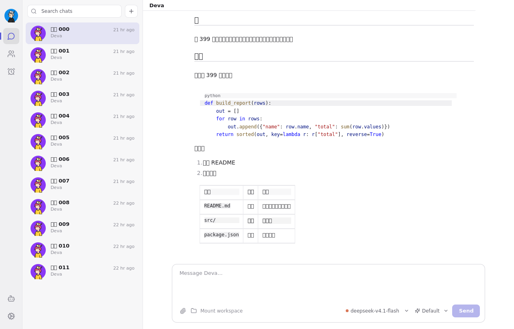
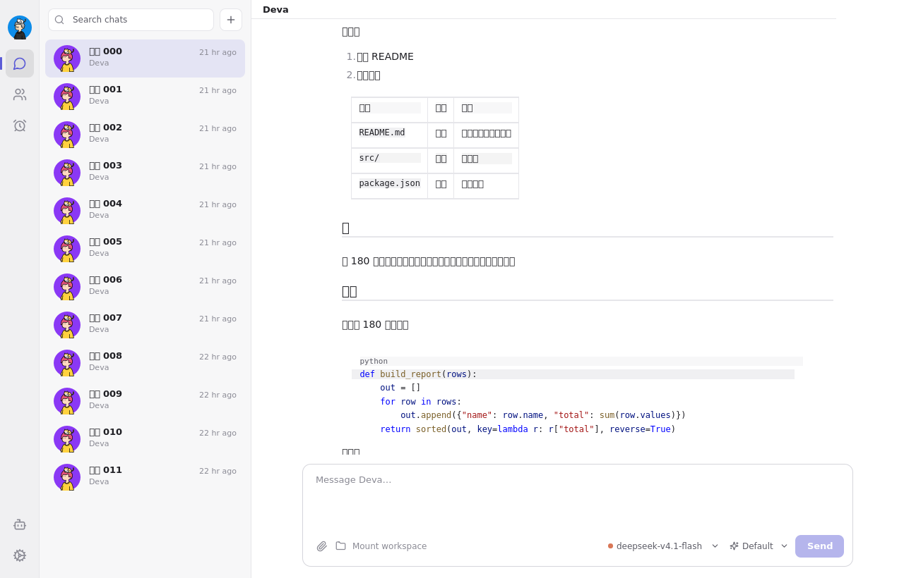
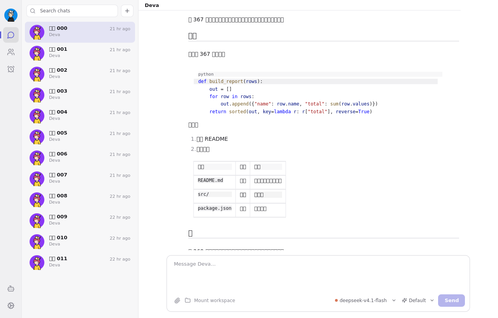

# 渲染残留项收口：自适应分块判据、表格逐格格式与热路径缓存

承接 `e711a5f`/`fb5cca8`（分块渲染）与 `4aaa631`/`c5b25df`/`3d6b94a`（表格一次插满行），
本轮只处理上一份报告留下的四项：

1. **自适应分组**：固定「每 50 块一组」改成按结构密度决定（整篇 / 50 / 32）；
2. **新表格路径下的分组复标定**：24 vs 50 vs 自适应，微基准与壳内双口径；
3. **渲染器剩余路径**：只有「表格逐格格式复用」拿到证据并被采纳，其余三项测完更慢、不改；
4. **`attach`**：维持「不动」结论，不重开调查。

- 仓库：`/home/agent/shared_workspace/ai_upper`，分支 `develop`
- 基线：`3d6b94a`（工作区无改动时开跑，`out/render-opt3/pytest-baseline.log` = 1245 passed / 5 skipped）
- 输出：`out/render-opt3/`
- QML、外部契约、依赖版本均未改动；`/home/agent/shared_workspace/deva` 全程只读。

**本报告的口径约定**：每个数字后面括号里注明来源日志；同一配置重复测量的极差一并写出，
差值落在极差内的不当收益讲。**长会话与短会话分开采样、分开报告**，不做奇偶混合取中位。

---

## 1. 结论

### 1.1 真壳（`out/render-opt3/click_split_ab.log`）

BEFORE 是把工作区三个改动文件 `git stash` 掉、代码真的退回 `3d6b94a` 后测的；
测完 `git stash pop`，并用 `md5sum` 逐个核对三个文件恢复原样。AFTER 在恢复后的工作区上测。
每侧 3 次独立进程，每次 5 轮（长/短在同一轮内交替，避免顺序漂移），共 15 个样本/侧。

| 口径（中位，3 次进程的中位数） | BEFORE（真 `3d6b94a`） | AFTER | 变化 |
| --- | --- | --- | --- |
| 长会话 400 轮 · `openSession` 同步段 | **2251.8 ms**（进程内 2222.7 / 2258.7 / 2251.8） | **1709.1 ms**（1715.5 / 1596.3 / 1709.1） | **−542.7 ms（−24.1%）** |
| 长会话 400 轮 · 首帧 | 755.6 ms | 758.3 ms | 噪声内 |
| 短会话 · `openSession` 同步段 | 65.9 ms（66.2 / 62.2 / 65.9） | 63.4 ms（63.4 / 61.7 / 64.0） | −2.5 ms，但两侧进程间极差 4.0 / 2.3 ms，算噪声内（无回归） |
| 短会话 · 首帧 | 91.1 ms | 91.0 ms | 噪声内 |

单次进程内全部样本的范围：长同步 BEFORE 2170.4–2273.8 ms、AFTER 1583.1–1730.9 ms；
短同步两侧都在 54.8–72.2 ms。三次进程中位数的极差：BEFORE 36 ms（1.6%），
AFTER 119 ms（7.0%）——两侧区间不重叠（BEFORE 最小 2222.7 > AFTER 最大 1715.5），
543 ms 的缺口远大于进程间漂移。

第二份独立口径 `out/render-opt3/shell_ab.log`（另一天、每侧单进程 4 个样本，中位）：
长同步 2173.0 → 1646.1 ms（−24.2%），短同步 68.2 → 63.5，长首帧 748.9 → 735.0，
短首帧 95.8 → 92.6。两份日志方向与幅度一致。

> 口径说明：早前一次回执里出现的「2260.4 → 1758.4 ms」在 `out/render-opt3/` 下**没有任何
> 日志记录**，本报告不使用该组数字。上面 BEFORE 的单次进程中位 2258.7 与 2260.4 接近，
> 但那只是本轮三次测量里的一次，不能替代整组。

### 1.2 渲染器（`out/render-opt3/ab_before_after.log`，交替 A/B，每档 3 次取最小）

| 正文 | 块数 | 判据 | BEFORE | AFTER | 加速 |
| --- | --- | --- | --- | --- | --- |
| mixed 400 轮 | 2800 | 32 | 951.3 ms | **567.5 ms** | ×1.68 |
| struct 400 轮 | 1200 | 32 | 766.5 ms | **432.9 ms** | ×1.77 |
| 纯段落 400 轮 | 800 | 整篇 | 54.8 ms | 27.7 ms | ×1.98 |
| mixed 12 轮（短文档） | 84 | 整篇 | 26.9 ms | 13.2 ms | ×2.04 |
| mixed 30 轮 | 210 | 整篇 | 67.2 ms | 41.4 ms | ×1.63 |
| mixed 120 轮 | 840 | 32 | 281.8 ms | 168.1 ms | ×1.68 |

四格 `toHtml()` / 块数 / 高度全等（`html_eq` / `blocks_eq` / `height_eq` 均为 true）。

逐块保真：**79 格**（2 种正文 × 6 个轮数 × 6 个固定分组 + 判据自选档）全部
`sig_eq` / `tables_eq` / `height_eq` / `html_eq` 为真；测试 **1260 passed / 5 skipped**；
**13 个变异全部被杀死**。

### 1.3 归因：分组与热路径各占多少（`out/render-opt3/attribution.log`）

`probe_attribution.py` 用 2×2 正交（旧/新热路径 × 旧/新分组），六种配置在**同一轮内交替**，
3 轮取最小；六个文档 `toHtml()` 与高度全等（`html_all_eq` / `height_all_eq` = true）：

| 正文 | 旧热路径 + 固定 50 | 旧热路径 + 判据分组 | 新热路径 + 固定 50 | 新热路径 + 判据分组 |
| --- | --- | --- | --- | --- |
| mixed_t400（2800 块，d=0.436，判据给 32） | 967.8 ms | 962.4 ms | 572.6 ms | **562.4 ms** |
| struct_t400（1200 块，d=0.73，判据给 32） | 802.7 ms | 812.7 ms | 451.5 ms | **445.3 ms** |

- **热路径单独**：967.8 → 572.6（mixed，−40.8% 墙钟）、802.7 → 451.5（struct，−43.8%）；
- **分组单独**（50 → 32）：967.8 → 957.6（mixed，−1.1%）、802.7 → 788.3（struct，−1.8%）；
- 两项合计降幅 405.4 ms / 357.4 ms 中，热路径占 **97.5% / 98.3%**。

注意同一有效配置（`gplan_raw` 与 `g32_raw` 在两份正文上都是分组 32）之间仍差 0.5% / 3.1%，
说明**这份探针里「分组」的差异（1–2%）压在测量抖动里**，分组档位的选择改由 §3 的 48 份
正文微基准决定，不靠这份归因。

---

## 2. 改动

三个文件，`git diff --numstat`：+394 −37（源码 +165 −31，测试 +229 −6）：

```
165  31  app/src/markdown/document.py
158   6  app/tests/test_markdown_chunked.py
 71   0  app/tests/test_markdown_document.py
```

### 2.1 自适应分块判据（`app/src/markdown/document.py`）

```python
_CHUNK_DENSITY_FLOOR = 0.15   # 密度低于此值：整篇更快
_CHUNK_PRESSURE = 45000       # 加权结构量 × 块数低于此值：还不够付拼接开销
_CHUNK_DENSE_GROUP = 32       # 高密度分组
_CHUNK_DENSE_DENSITY = 0.40   # 高密度门槛

def _structural_load(blocks): ...      # 表格 1.0 / 代码 0.6 / 引用 0.59 / 分隔线 0.38 / h2 0.43
def _chunk_plan(blocks) -> int:        # 0 = 整篇；否则每组的顶层块数
```

判据的三段（全部由 §3 的实测支撑）：

| 条件 | 选择 | 依据 |
| --- | --- | --- |
| `count <= 50` | 整篇 | 该规模二次成本可忽略，分块要付拼接钱 |
| 密度 `< 0.15` 或 `load×count < 45000` | 整篇 | 纯段落/稀疏结构整篇就是线性；小文档分块反而慢 |
| 密度 `>= 0.40` | 32 | 高密度段小组更省 |
| 其余（0.15~0.40） | 50 | 结构稀疏，小组多付拼接钱 |

`_render_chunked` 增加显式 `group` 参数（0 表示沿用 `_CHUNK_BLOCKS`，测试与探针按
指定分组驱动这条路径用）。

### 2.2 热路径（同样是 `document.py`）

| 改动 | 证据 |
| --- | --- |
| `css_color` 加 `@lru_cache`，按原字符串命中 | 单次解析 2.413 µs vs 查表 0.073 µs；400 轮正文 19600 次调用（`micro_cache.log`、`hot_paths.log`） |
| `_font_for` / `_line_spacing` 按「族+像素+粗+斜」缓存 | 单次构造 5.001 µs、度量 1.302 µs；400 轮正文 20400 / 12400 / 9600 次（同上） |
| `_table_row` 复用单元格格式（表头/斑马行、对齐、表头+正文） | 交替 A/B（分组 32）701.8 → 596.0 / 652.0 → 554.0 / 647.5 → 552.2 ms；分层（分组 32）head 660.3 vs source 568.2 ms，见 §4.1 |

`QTextFormat` 是隐式共享的值类型，`setFormat`/`QTextCharFormat(fmt)` 都只做浅拷贝，
所以同一个 `QTextTableCellFormat` / `QTextCharFormat` 实例可以安全地交给多个单元格。
这一点由 §5 的 79 格保真矩阵与 13 个变异共同锁定。

> 更正：上一版报告和源码注释里写的「684.2 → 594.8 ms」「661.6 → 611.9（−49.7）」在
> `out/render-opt3/` 下**找不到对应日志**（`grep` 全部 miss），已按本轮保存的
> `cell_reuse.log` / `cell_levels.log` 改写；`document.py` 的 docstring 同步更正。

### 2.3 测试（`app/tests/test_markdown_chunked.py`、`test_markdown_document.py`）

新增/改写 **14 个测试函数**（其中 `test_adaptive_groups_render_identically_to_the_whole_path`
参数化 2 档，合计 **15 个用例实例**，正好对上 1245 → 1260）：

- 判据：纯段落/稀疏/小文档留在整篇；0.31 档走 50；0.50 档走 32；判据值真的传进
  `_render_chunked` 且每块不超过它；
- `_structural_load` 的引用递归与 h2 权重；
- 两种自适应档（32 与 50）各自与整篇逐块一致（含表格形状）；
- 三张缓存的命中与键区分；表格正文不加粗。

---

## 3. 自适应判据的证据

### 3.1 前提：纯段落没有二次成本

`probe_quadratic.py`（整篇路径，24 → 4800 块，log-log 最小二乘，`quadratic.log`）：

| 正文 | 整篇规模指数 | 每块耗时（24 → 4800 块） |
| --- | --- | --- |
| 纯段落 | **0.999** | 0.038 → 0.036 ms（平坦） |
| 每轮一张表 | **1.421** | 0.154 → 1.472 ms（随规模涨 9.6×） |

同一份纯段落文档，分块在任何规模都更慢（g16 加速比 0.67~0.72，g50 0.78~0.79），
所以「密度为 0 → 整篇」是硬结论而不是经验。表格文档的交叉点在 120 轮（g16 ×0.95）
与 400 轮（×1.62）之间，之后迅速拉开（1200 轮 ×3.41、2400 轮 ×6.17）。

### 3.2 密度 → 最优分组（微基准）

`probe_plan_check.py`（`plan_check.log`，48 份正文 × 7 档 × 3 次取最小）。下表每行取同密度
里块数最大的那份，数字是该日志里的 `ms` 字段原值：

| 密度 | 正文 / 块数 | 整篇 | g16 | g24 | g32 | g50 | 最优 |
| --- | --- | --- | --- | --- | --- | --- | --- |
| 0.000 | qpara_t2400 / 4800 | **176.1** | 244.0 | 231.4 | 226.5 | 219.9 | 整篇 |
| 0.059 | d06_t1200 / 1275 | **79.8** | 102.6 | 97.4 | 94.3 | 91.2 | 整篇 |
| 0.160 | d20_t1200 / 1500 | 222.9 | 186.4 | 178.9 | 175.0 | **171.7** | 50 |
| 0.313 | d43_t400 / 700 | 145.9 | 115.3 | 112.9 | 111.4 | **110.2** | 50 |
| 0.365 | b36_t400 / 799 | 219.5 | 145.8 | 143.4 | 142.0 | **141.7** | 50（32 差 0.2%） |
| 0.400 | b40_t400 / 800 | 263.0 | 176.1 | 172.6 | **172.0** | 173.2 | 32（50 差 0.7%） |
| 0.437 | d67_t400 / 1200 | 536.6 | 234.5 | 229.5 | **228.6** | 231.0 | 32 |
| 0.517 | d52_t400 / 1400 | 902.4 | 326.0 | **322.0** | 324.3 | 328.3 | 24（32 差 0.7%） |
| 0.730 | sweep_struct_t400 / 1200 | 1296.7 | **423.4** | 425.0 | 429.4 | 443.5 | 16（32 差 1.4%） |

0.365 与 0.40 这两点 24/32/50 只差 0.2~0.8%，是判据交界可以落脚的平台；
0.400 起 32 连续最优，0.73 上 16 略优 1.4%——见 §6 的「未采纳」。

独立佐证 `group_calib.log`（另一套生成器，4 个密度档）：d06_t1200 140.4（g50，整篇 129.0）、
d20_t1200 274.5（g50）、d43_t1200 547.7（g32）、d67_t400 367.2（g32），与上表同向。

### 3.3 判据复核：选中的档 vs 逐档最优

`probe_plan_check.py` 对 48 份正文各扫 7 档（整篇/8/12/16/24/32/50），判定标准是
「相对损失 ≤ 2% **且** 绝对差 ≤ 2 ms」（绝对门槛来自 `probe_plan_noise.log`：同一配置
重复 6 次，小文档极差 0.3~11 ms，中文档 5 ms）：

| 判据 | 最差损失 | 平均损失 | 超限正文 |
| --- | --- | --- | --- |
| 旧：16@0.30 / 50 | +4.6% | +0.94% | 9 份 |
| **新：32@0.40 / 50** | **+1.4%** | **+0.10%** | **0 份** |
| 32@0.35 / 50 | +1.4% | +0.09% | 0 份 |
| 32@0.45 / 50 | +1.4% | +0.20% | 0 份 |
| 24@0.40 / 50 | +1.1% | +0.13% | 0 份 |
| 16@0.40 / 50 | +2.8% | +0.55% | 4 份 |

选 32 而不是 24：24 的「最差损失」更小（1.1% vs 1.4%），但均值略差，两者都在容差内、
差值远小于抖动；32 在 0.44 与 0.50 两个密度带都稳定最优，取它作为唯一的高密度档。

### 3.4 真实正文上的抽查

`probe_plan_real.py` 直接读 `probe_heavy` 生成的 40 条会话正文（400 轮长会话 3200 块、
164578 字符）：密度 **0.307**，判据选 **50**（`plan_real.log`）。`probe_real_group.py`
在这份真实正文上交替测 5 档（`real_group.log`）：

| 整篇 | g16 | g24 | g32 | g50 |
| --- | --- | --- | --- | --- |
| 2394.8 ms | 670.1 | 667.9 | 663.6 | **669.2** |

四档相差 ≤ 1.0%，说明这一档怎么选都在噪声内——但旧判据在 0.31 的合成正文上会选 16，
那边要慢 4.6%（§3.2/§3.3），所以新判据正确地维持 50。

### 3.5 壳内分组复标定：不可复现，只保留「整篇明显更差」

`probe_shell_groups.py` 每档单进程、40 会话 × 400 轮 × 4 次，长会话 `openSession` 同步段中位：

| 批次（日志） | plan | g24 | g32 | g50 | whole |
| --- | --- | --- | --- | --- | --- |
| `shell_groups.prev.log` | **1618.4** | 1641.0 | 1683.4 | 1628.3 | 3664.5 |
| `shell_groups.run1.log` | 1654.6 | 1618.4 | **1616.1** | 1651.9 | — |
| `shell_groups.log`（最新） | 1678.4 | 1717.5 | 1693.7 | **1633.3** | — |

三批的最优档分别是 plan / g32 / g50，同一配置跨批次能差 100 ms（g32：1683.4 / 1616.1 / 1693.7）。
结论：**壳内分组差异（1~5%）不可复现，判据按微基准（§3.2/§3.3）定；只有「整篇」在壳里
明显更差（3664.5 ms，×2.2）**。上一轮任务要求补的 g24 档已在最新批次中测到（1717.5 ms），
与 g32/g50 无法区分。

---

## 4. 渲染器剩余路径

### 4.1 采纳：表格逐格格式复用

**分层**（`probe_cell_levels.py`，`cell_levels.log`，400 轮 mixed，5 轮交替取最小）。
两种分组都列出来，避免「用了旧分组的数据」：

| 层次 | 分组 32（判据实际会给的档） | 相对 source | 分组 16（对照） | 相对 source |
| --- | --- | --- | --- | --- |
| `head`（逐格新建格式，HEAD 口径） | 660.3 ms | **+92.0 ms** | 655.1 ms | +84.4 ms |
| `no_char`（去掉字符格式缓存） | 586.7 ms | +18.5 ms | 576.2 ms | +5.5 ms |
| `no_block`（去掉块格式缓存） | 590.3 ms | +22.1 ms | 585.2 ms | +14.5 ms |
| `source`（当前源码） | **568.2 ms** | — | 570.7 ms | — |

三档 `html_eq` / `height_eq` 全为 true。读法：把单元格格式改成逐格新建，要多付 92.0 ms；
字符、块两张小缓存各自值 18.5 / 22.1 ms（这两档各自单独拆，不相加）。

**交替 A/B 复核**（`probe_cell_reuse.py`，`cell_reuse.log`，分组 32，每次 5 轮交替取最小，
3 次独立进程）：

| 进程 | BEFORE | AFTER | Δ | 加速 |
| --- | --- | --- | --- | --- |
| 1 | 701.8 ms | 596.0 ms | −105.8 ms | ×1.18 |
| 2 | 652.0 ms | 554.0 ms | −98.0 ms | ×1.18 |
| 3 | 647.5 ms | 552.2 ms | −95.4 ms | ×1.17 |

三次 Δ 都在 95–106 ms，方向一致；同探针的 48 格保真（3 种正文 × 4 个轮数 × 4 个分组）
全部 `ok`。绝对值跨进程有 50 ms 漂移，所以结论按**Δ 与方向**陈述，不拿某一档绝对值当基线。

### 4.2 测完不改：三项（`probe_rest_paths.py`，`rest_paths.rerun.log`）

400 轮 mixed，分组 32，基准与三个变体**同一轮内交替**，3 次独立进程：

| 变体 | 第 1 次 Δ | 第 2 次 Δ | 第 3 次 Δ | 结论 |
| --- | --- | --- | --- | --- |
| 复用 `QFontMetricsF` 度量对象 | −10.6 ms | −10.7 ms | −9.2 ms | 稳定更慢 ~10 ms，不改 |
| 代码块指标改一次算好 | −14.4 ms | −14.0 ms | −11.0 ms | 稳定更慢 ~13 ms，不改 |
| 去掉 `str.replace` 的临时字符串 | −42.6 ms | −36.2 ms | −36.0 ms | 稳定更慢 ~38 ms，不改 |

（Δ = 基准 − 变体，负数表示变体更慢。）三档 `html_eq` / `blocks_eq` / `height_eq` 全为 true，
即它们**不是**保真问题，是纯速度问题。早先串行测量时这里出现正负翻转（+1.3 / −1.4 / +2.2），
是「先跑完基准再跑变体」的顺序漂移；改成交替后三次方向一致，才敢下「不改」的结论。

### 4.3 `attach`：维持原结论，未重开

上一轮已归档的三条反证（不重跑 → 0 个着色块；显式 rehighlight 8.9 s；跨文档
`FormatRange` 高度塌成 0）本轮未重跑、也未改动任何 attach 相关代码。
`openSession` 长会话首帧 755.6 → 758.3 ms（§1.1）属噪声，与之一致。

---

## 5. 保真与测试

### 5.1 保真矩阵（`probe_fidelity_matrix.py`，`fidelity_matrix.rerun.log`）

两种正文（RICH：引用/嵌套引用/列表/任务列表/图片/表格；dense：每轮两张表+代码+引用）
× 6 个轮数（5/12/30/60/120/400）× 固定分组 5/16/25/50/100 + 整篇 + 判据自选档。

| 系列 | 轮数 → 块数 | 判据 | 格数 |
| --- | --- | --- | --- |
| RICH | 65 / 156 / 390 / 780 / 1560 / 5200 | 整篇 / 整篇 / 50 / 50 / 50 / 50 | 40 |
| dense（密度 0.79） | 20 / 48 / 120 / 240 / 480 / 1600 | 整篇×3 / **32**×3 | 39 |

**79 格全部 0 差异**：每块文本与块格式、每个字符片的字体/像素/字重/斜体/前后景、
表格形状（行列数/宽度/边距/边框/间距）、文档高度、`toHtml()` 逐字节相等。
`failures` 为空。本轮重跑（同日、当前源码）结果与上一份日志逐格一致。

### 5.2 测试与变异

- 全量：**1260 passed, 5 skipped**（基线 1245 + 15 个新用例实例），`out/render-opt3/pytest.log`
  （命令见文末）。
- 变异：`out/render-opt3/mutation_check.sh` 13 项**全部被杀死**（`mutation_check.rerun.log`，
  本轮重跑）：密度门槛置 0、规模门槛置 0、高密度组改用 50、高密度门槛退回 0.30、引用不递归、
  h2 不计数、颜色缓存返回固定值、字体缓存丢 bold、行高缓存丢字号、分组参数被忽略、
  单元格格式丢斑马行、块格式丢对齐、字符格式丢表头区分。每个变异都能点名到具体用例。

### 5.3 真实壳截图（`out/render-opt3/shots/`，`shot.rerun.log`）

命令：

```
env -u AI_UPPER_HOME LD_LIBRARY_PATH=/tmp/qtlibs QT_QPA_PLATFORM=offscreen \
  .venv/bin/python out/conversation-picker-lag/probe_shot_long.py out/render-opt3/shots
```

真实 `Main.qml` + `QQmlApplicationEngine`（offscreen 平台），读回 `bodyView`：
**13200 块 / 136580 字符 / 内容高 239221.75 / 视口 618.0**，滚到 top / mid / bottom 各截一张。







- `long-session-top.png`：h2 下划线、代码块语法着色（关键字/字符串/数字三色）、表格边框与斑马行；
- `long-session-mid.png` / `long-session-bottom.png`：滚到中段与底部后同样的着色与表格。

（截图里中文显示为缺字方框，是该容器的字体缺失，与渲染路径无关；着色、表格线、
斑马行、标题下划线都正常。）

---

## 6. 未做/未验证

| 项 | 状态 | 原因 |
| --- | --- | --- |
| `attach` 的 ~780 ms `endEditBlock` | 未改动 | `QQuickTextEdit` 整篇布局的内生成本；三条反证已归档，本轮按用户要求不重开 |
| 密度 0.73 上 g16 略优（423.4 vs g32 429.4，+1.4%） | 未采纳 | 差值 1.4%，小于判据容差；为它单独加一档只会增加分支与测试面 |
| 壳内首帧的收益 | 未观测到 | 首帧主要由 `attach` 决定（§4.3），本轮不涉及 |
| 分组对壳内长会话的贡献 | 观测不到 | 真实正文密度 0.307 → 判据选 50（§3.4），本就不该换档；且壳内分组差异不可复现（§3.5） |
| 壳内分组的最优档 | 未定论 | 三批日志互相矛盾（plan / g32 / g50 各赢一次），差异 1–5% 在噪声内；判据依据微基准 |
| 「`_apply_cell_borders` 并入 `_table_row`」的说法 | 术语更正 | 工作区与 `3d6b94a` 中都**没有** `_apply_cell_borders` 符号（`grep` 0 命中）；边框是在 render-opt2 里直接写进 `_table_row` 的同一次 `setFormat`，本轮只是在此基础上加了三张格式缓存 |
| 旧报告中的 684.2→618.8→613.8→594.8、661.6→611.9、416.4/416.5/420.5/436.5 | 已删除 | `grep` 在这些数字上于 `out/render-opt3/*.log` 全部 0 命中，无日志支撑；已替换为 §3.2 / §4.1 的有据数字 |
| 早前回执里的壳内长同步 2260.4→1758.4 ms | 不使用 | 无对应日志；以 `click_split_ab.log`（stash 真退回）与 `shell_ab.log` 为准 |

---

## 附：复现命令

```bash
cd /home/agent/shared_workspace/ai_upper
PY="env -u AI_UPPER_HOME HOME=\$(mktemp -d /tmp/ai-upper-home-XXXX) \
    LD_LIBRARY_PATH=/tmp/qtlibs QT_QPA_PLATFORM=offscreen .venv/bin/python"

$PY -m pytest app/tests -q                      # 1260 passed, 5 skipped
$PY out/render-opt3/probe_fidelity_matrix.py    # 79 格，failures: []
bash out/render-opt3/mutation_check.sh          # 13 MUTANT，全部 FAILED
$PY out/conversation-picker-lag/probe_click_split.py 40 400 5 <label>   # 长/短分开
$PY out/conversation-picker-lag/probe_shot_long.py out/render-opt3/shots
```

BEFORE 口径（真 `3d6b94a`）：

```bash
git stash push -m before -- app/src/markdown/document.py \
  app/tests/test_markdown_chunked.py app/tests/test_markdown_document.py
# 跑 probe_click_split.py，然后
git stash pop
```
