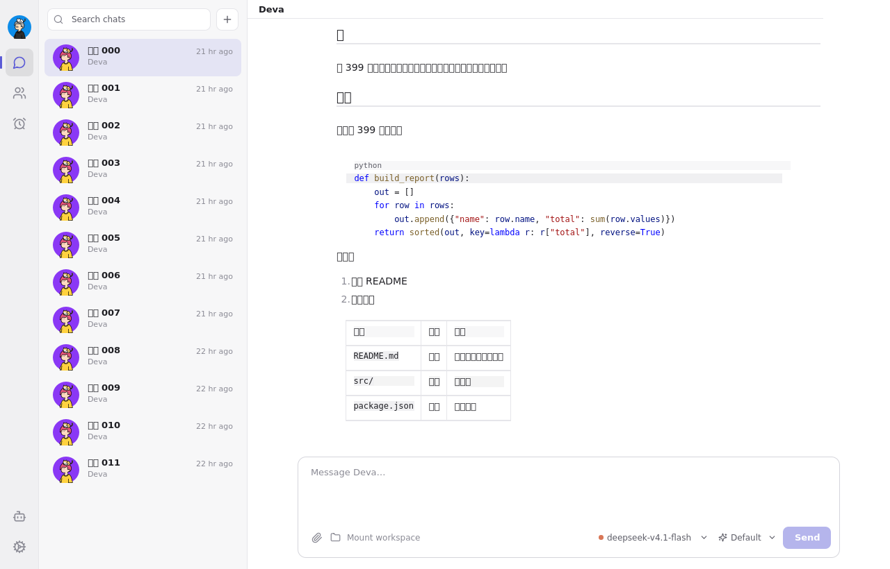
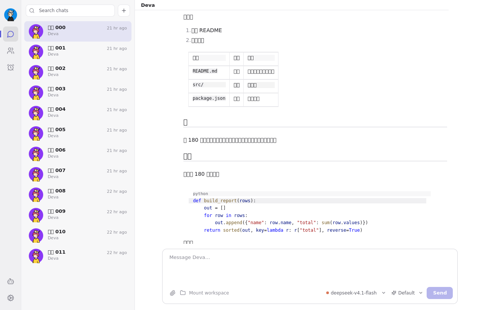
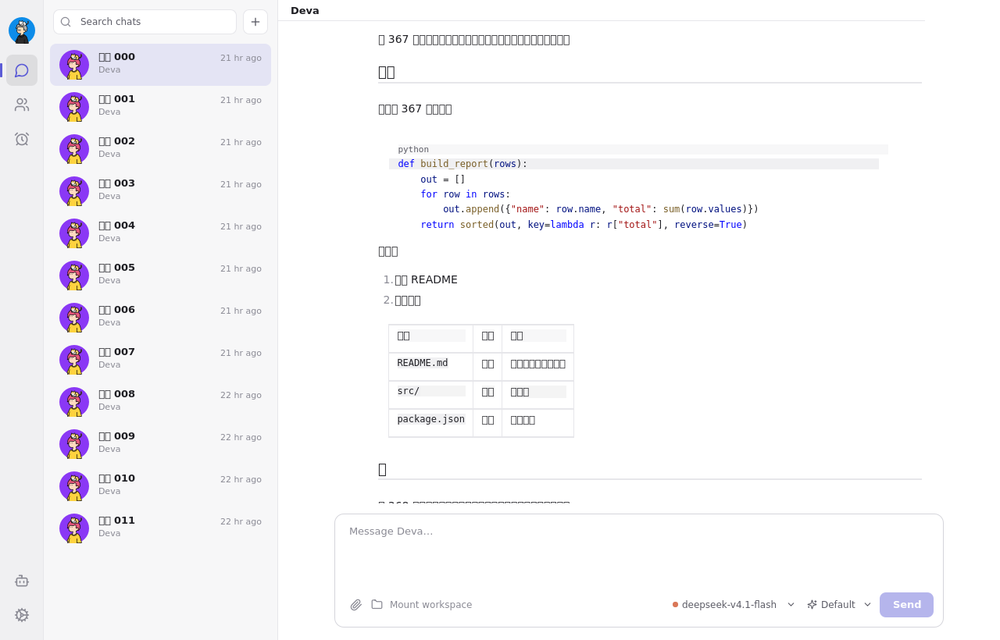

# 同步段收口：两个 attach 候选逐条证伪，代码未改

本轮的命题很窄：上一轮把长会话 `openSession` 同步段压到约 1.7 s 之后，同步段里
`endEditBlock`（约 720 ms）已是最大单块，`body_render`（约 700 ms）次之。本轮只回答两个
问题——**整篇替换文档**与**排版预算/延迟提交**能不能在不改动保真度的前提下变快。

结论：**两个方向都证伪，`app/src` 一行未改**。本轮产出全部是证据（探针 + 日志 + 报告 + 截图）。

- 仓库：`/home/agent/shared_workspace/ai_upper`，分支 `develop`
- 起点：`3f01757`（工作区 `app/src` 无改动，`git status --porcelain -- app/src` 为空）
- 输出：`out/render-opt4/`
- 判定门槛（沿用）：**同一口径下的微基准为正** 且 **逐块保真 0 差异**；缺一即记「未改 + 原因」
- QML、外部契约、依赖版本均未改动；`/home/agent/shared_workspace/deva` 全程只读；
  `AI_UPPER_HOME` 一律指向 `/tmp/ai-upper-*`

**口径约定**：每个数字后面标出所属日志；同一配置的重复测量极差一并写出，差值落在极差内的
不当收益讲。长会话与短会话分开采样。

---

## 1. 判词

| 方向 | 判词 | 依据 |
| --- | --- | --- |
| 候选 A：把整篇内容装进一份新 `QTextDocument`，再用 `setTextDocument()` 换掉 | **等价但更慢，不改** | 7 项等价判据全过，但同步段 1676.9 vs 1644.6 ms（`attach_replace.log`） |
| 候选 B：排版预算 / 延迟提交（`setLayoutEnabled(False)`、`blockSignals`、推迟 `endEditBlock`） | **三种手法全部证伪** | 省下的正是「没做的排版」，视图状态与像素都不对；推迟只改顺序不改总和（`attach_defer.log`） |
| 附带：`body_render` 里 parse+render_blocks 之外的 ~172 ms | **已归因，不是高亮器，不改** | 64 次分块拼接 + 资源搬运 + 循环开销（`render_residual.log`） |

---

## 2. 本轮同步段拆解（`out/render-opt4/sync_split.log`）

400 轮 / 13200 块长会话，3 个独立进程 × 每进程 3 轮，长短会话同轮交替、奇数轮倒序。
下表是 **9 个长会话样本的中位数**（括号内为极差）：

| 阶段 | 中位 ms | 极差 |
| --- | ---: | --- |
| `openSession` 同步段总计 | **1598.0** | 1560.1–1668.6 |
| `body_render` | **702.3** | 680.6–718.4 |
| ├ `parse_markdown` | 44.4 | 44.1–45.3 |
| └ `render_blocks`（64 次调用） | 486.0 | 471.5–505.7 |
| `attach_total` | 873.1 | 867.8–943.6 |
| ├ `endEditBlock`（**最大单块**） | **719.5** | 715.8–737.5 |
| ├ `frag_build` | 51.4 | 50.8–68.2 |
| ├ `insert_frag` | 57.8 | 56.1–59.9 |
| ├ `remove_old` | 0.2 | 0.1–33.4 |
| └ `images`（`_copy_images`） | 41.8 | 41.2–42.9 |
| `publish` | 10.7 | 10.1–11.7 |

短板会话（同轮交替）同步段中位 57.1 ms（9 个样本 8.0–70.2；双峰来自「切到短会话」
与「短会话切回短会话」两种起点，两者都在 70 ms 内）。

`body_render` 里的 parse + render_blocks 只占 530.4 ms，余下约 172 ms 不在分块路径上。
本轮补了归因（`out/render-opt4/render_residual.log`，3 次开长会话）：

| 项 | 中位 ms | 样本 |
| --- | ---: | --- |
| `body_render` | 734.2 | 737.4 / 731.1 / 734.2 |
| `parse_markdown` | 45.5 | 44.8 / 45.5 / 45.9 |
| `render_blocks`（64 次） | 510.1 | 515.3 / 505.7 / 510.1 |
| `_render_chunked` 整体 | 680.8 | 689.8 / 677.8 / 680.8 |
| ├ 64 次 `insertFragment` 拼接 | 60.0 | 61.3 / 60.0 / 59.7 |
| ├ 64 次 `_copy_resources` | 41.4 | 41.4 / 41.1 / 41.4 |
| └ 分块循环其余部分（scratch 建文档、断块、块格式回填） | 71.0 | 71.8 / 71.0 / 69.6 |
| `document.clear()` | 4.8 | 0.1 / 5.1 / 4.8 |
| `_collapse_edge_margins` | 0.0 | 0.0 / 0.0 / 0.0 |

即：`body_render ≈ parse(45) + 每块渲染(510) + 拼接(60) + 图片资源(41) + 循环开销(71) + 清空(5)`。
**高亮器在这段里 0 次调用**（`highlightBlock` 探针在 `BodyDocument.render` 期间计数为 0；
总计 13200 次全部发生在 `attach` 的 `contentsChange` 里）——与 `out/render-opt2/highlight_phase2.log`
的结论一致。拼接与资源搬运是分块渲染的固有代价（分块本身的净收益在上一轮已单独量化：渲染器层
400 轮整篇 10084.5 → 1825.3 ms，5.52×，见 `out/render-chunking/chunk_matrix_after.json`），
不属于可再压的成本。

> 探针自身的一个错：第一版把 `highlightBlock` 计数门槛绑在「整个 `openSession` 期间」，
> 于是 13200 次 attach 里的调用被算成「渲染期间」，差点得出「高亮器在 `body_render` 里跑了
> 13200 次」的反向结论。改成只在 `BodyDocument.render` 内部计数后为 0
> （`render_residual.log` 的 `highlightBlock_calls` 只剩 `{"all": 13200}`）。

---

## 3. 候选 A：整篇替换文档（`setTextDocument`）

### 3.1 探针口径

`out/render-opt4/probe_attach_replace.py`：真实 `Main.qml` + `ShellBridge`，打开 400 轮长会话。
每个样本先渲染进自有文档，再分别用两条路径装进 QML：

- `insert`：线上路径（`attach`：`beginEditBlock` → 删全文 → `insertFragment` → `endEditBlock`）；
- `replace`：新建一份 `QTextDocument`（`setDefaultFont` 对齐成 QML 的 `DejaVu Sans 14px`），
  渲染进去，然后 `setTextDocument()`；
- `replace_nohl`：同上但新文档不挂高亮器（用来证明「颜色」这一项判据本身能判错）。

5 轮，奇偶轮正反交替（实际顺序 insert/replace → replace/insert → …）。

七项等价判据：块数、文档高度、表格数、**着色签名（读 `block.layout().formats()`）**、
`toHtml()` sha、**QML 视图状态**（`implicitHeight` / `bodyScroll.contentY`）、
**整帧像素 sha（掩掉 x∈[289,295) 的「21 hr ago」时间列）**。

### 3.2 结果（`out/render-opt4/attach_replace.log`，5 轮中位数）

| 指标 | insert（线上） | replace | 差 |
| --- | ---: | ---: | ---: |
| `render` | 736.5 | 863.7 | **+127.2** |
| `transfer` | 899.4 | 801.8 | −97.6 |
| `publish` | 10.9 | 11.6 | +0.7 |
| `settle`（30 次 processEvents） | 743.8 | 768.6 | +24.8 |
| **同步段（render+transfer+publish）** | **1644.6** | **1676.9** | **+32.3** |
| **端到端（含 settle）** | **2395.8** | **2445.5** | **+49.7** |
| 七项等价 | 5/5 全 true | 5/5 全 true | — |

两侧的进程内极差：insert 同步 1614.6–1654.2（39.6 ms），replace 1652.3–1705.5（53.2 ms）。
两侧区间**重叠**（replace 最小 1652.3 < insert 最大 1654.2），32.3 ms 的差本身落在噪声边缘；
但端到端 49.7 ms 与 `render` 一侧的 +127 ms 方向一致，且 `render` 的机制可解释：
替换路径里新文档脱离视图，高亮器必须**先在无人观察的文档上把 13200 块全跑一遍**，
而线上路径的着色是在 `endEditBlock` 的 `contentsChange` 里顺带完成的。
`transfer` 省下的约 98 ms 不足以抵消它。

`replace_nohl`（1 轮）用来验判据：同步 1253.5 ms 看起来最快，但
`colour_eq=False、html_eq=False、frame_eq=False、colour_runs=0`——颜色全丢，被正确判为不等价。
对应像素证据：`out/render-opt4/crops/r4_insert.png` vs `r4_nohl.png`，
2 倍放大 `code_hl_2x.png` vs `code_nohl_2x.png`（后者代码块整段灰）。

### 3.3 判词

**等价成立，但没有收益：同步段 +32.3 ms、端到端 +49.7 ms，均已超过或贴近噪声。**
不采纳。三条归档反证仍然成立且未被本轮削弱：

1. 不重跑高亮 ⇒ 目标文档 0 个着色块（`out/render-opt2/reorder_highlight.log`）；
2. 显式 `rehighlight()` 8.9 s（同上）；本轮 `replace_nohl` 从另一侧复现了第 1 条；
3. 跨文档搬 `FormatRange` 会把块高打成 0（`markdown/body.py` 模块文档的历史反例）。

---

## 4. 候选 B：排版预算 / 延迟提交（`attach_defer.log`）

### 4.1 先算账

线上 attach 的同步成本是这几项之和（本轮 `sync_split.log` 中位）：
`frag_build 51.4 + remove_old 0.2 + insert_frag 57.8 + endEditBlock 719.5 + images 41.8 = 870.7`
≈ `attach_total 873.1`。`endEditBlock` 的 719.5 ms 是 `QQuickTextEdit` 在编辑块提交时对
整篇文档做排版——**它是首帧之前必须完成的工作**。把 `endEditBlock` 推迟到事件循环，
同步段当然变短，但这份排版不会消失，只是换到 settle 里做；除非测量能证明总和变小，
否则「延迟提交」只是把同一次卡顿挪到下一帧。

### 4.2 实测（3 轮，正向/反向交替；`attach_defer.log`）

| 模式 | render | transfer | settle | 同步段 | 端到端 | 等价性 |
| --- | ---: | ---: | ---: | ---: | ---: | --- |
| `base`（线上） | 726.7 | 886.0 | 730.6 | 1624.3 | 2356.3 | 7/7 全 true |
| `nolayout`（搬运期间 `setLayoutEnabled(False)`） | 725.6 | **293.0** | **1354.7** | **1029.5** | 2384.2 | `view_eq`/`frame_eq` **false** |
| `nosignal`（搬运期间 `blockSignals(True)`） | 723.9 | **606.2** | **5.2** | 1341.2 | 1345.7 | 着色/HTML/视图/像素 **4 项 false** |
| `defer`（`endEditBlock` 推迟到 `QTimer.singleShot(0)`） | 735.1 / 729.8 | — | — | **0.0** | settle-to-stable 1609.4 / 1620.8 | — |

- **`nolayout`**：同步段少 594.8 ms，但少掉的正是「没做的排版」——`implicitHeight` 停在上一份
  文档的 581.98、`contentY` 停在 7.98、`contentHeight` 停在 625.98（三轮完全一致），
  文档本身却是对的；端到端反而 +27.9 ms。**假加速。**
- **`nosignal`**：端到端 1345.7 ms 看着最快，但高亮器收不到 `contentsChange`，
  `colour_eq/html_eq` 全 false，视图也没刷新。**结果不对。**
- **`defer`**：同步段 0.0 ms，但从调用到画面稳定 1609.4 / 1620.8 ms；加上渲染 735.1 / 729.8，
  合计 2344.5 / 2350.6 ms，与 `base` 的 2356.3 ms 只差 5.7–11.8 ms（噪声内）。
  **只改顺序，不改总和。**

### 4.3 旁证：分块提交也不是可按段摊销的成本

`out/render-opt2/attach_layout.log`（400 轮，13200 块）：一次提交 880.1 ms；
拆成 66 个编辑块（每 200 块）合计 1009.1 ms；拆成 17 个（每 800 块）823.8 ms 但删除开销
从 8.8 涨到 26.4，总时长 960.7 > 880.1。`setUndoRedoEnabled(False)`
（`out/render-opt2/attach_undo.log`）：提交 758.4 → 760.1 ms，无变化。

### 4.4 判词

**`nolayout` 与 `nosignal` 结果不等价，`defer` 总和不变。三项全部证伪，不采纳。**

---

## 5. 保真抽查（本轮重跑）

`out/render-opt4/fidelity_matrix.rerun.log`（本轮新跑）+ `summarize_fidelity.py`：

- 12 个用例（rich / dense × 5/12/30/60/120/400 轮，含 RICH 图片文档与密度 0.79 的 dense 文档）；
- 两个 400 轮用例 × 7 个分组（whole/5/16/25/50/100/planned）共 **14 格**；
- 每格 `sig_eq` / `tables_eq` / `height_eq` / `html_eq` 全 true；
- `failures: []`，全矩阵 `bad cells anywhere: []`。

`out/render-opt4/fidelity_matrix.log` 与上一轮 `out/render-opt3/fidelity_matrix.log`
md5 相同（`4968ee28…`），本轮 `fidelity_matrix.rerun.log` 复跑结果一致。

代码未改，故本轮不需要新的变异验证；上一轮 `out/render-opt3/mutation_check.log`
（13 个变异全部被杀死）仍对应当前源码。

全量测试本轮重跑：`out/render-opt4/pytest.rerun.log` = **1260 passed / 5 skipped**
（29.10 s；须带 `LD_LIBRARY_PATH=/tmp/qtlibs` 与 `QT_QPA_PLATFORM=offscreen`，
否则 Qt 相关用例在收集期就因 `libEGL.so.1` 缺失报错）。

---

## 6. 本轮发现并修掉的探针错误（防止「测了个假的」）

这些不影响线上代码，但会让结论反向，记录在此：

1. **着色判据读错 API**：初版读 `QTextBlock.textFormats()`，它只返回块的基础格式，
   于是 `replace_nohl` 被判成「着色等价」。`textFormats()` 在两份文档里都返回 1 个
   `#1f1f24` 基础 run，而 `layout().formats()` 是 3（有高亮）vs 0（无高亮）。
   已改为读 `layout().formats()`——`replace_nohl` 立即变为 `colour_runs=0, colour_eq=false`。
2. **`convertToFormat(...).bits()` 段错误**：未留引用的临时 `QImage` → 悬垂指针，
   探针 exit 139。改为先绑定 `flat = image.convertToFormat(...)` 再取 `scanLine`。
3. **整帧像素误报**：同模式样本之间差 34–136 px，定位后全部落在 x∈[289,294] 的
   「21 hr ago」时间列（跨分钟闪烁）。两侧探针均改为把该列从哈希里掩掉。
4. **默认字体不一致**：新建 `QTextDocument` 默认 `Sans Serif 9pt`，QML 文档是
   `DejaVu Sans 14px`，400 轮几何差 2400 px。补 `setDefaultFont(ui_font)` 后两侧高度
   精确相等（239177.75 == 239177.75，`html_len` 均 6484648），剩余 HTML 差异经程序分类
   全部是 `-qt-user-state:0` 属性，块文本与高度逐块相同。
5. **`nolayout` 的假加速**：初版等价判据只看文档层，漏了 QML 视图状态，把
   「控件没刷新」判成等价。补 `implicitHeight`/`contentY`（`view_eq`）与整帧像素（`frame_eq`）
   后该模式才被正确证伪。
6. **高亮器计数口径**（见 §2 末）：计数门槛从「整个 openSession」改为「`BodyDocument.render` 内」。

---

## 7. 整条优化线逐轮总账

每一行的数字都标注了对应日志。**注意口径不同**：分块轮的点击探针用 120 个会话，
opt2/opt3/本轮用 40 个；跨轮只看方向与量级，不拿不同口径的绝对值相减。

| 轮次 | 提交 | 改动 | 长会话同步段 | 分段证据 | 日志 |
| --- | --- | --- | --- | --- | --- |
| 0 | `b513d7c` / `c67a402` / `ea75897` | 正文先渲染到脱离视图的文档，再一次性搬进 QML；高亮器不再对上一份大文档全量重跑 | 修复后 **2805.6 ms**（最大 5652.9）；修复前原始基线**无日志留存，不写入本表** | — | `out/conversation-picker-lag/after-latency.log` |
| 1 | `e711a5f` / `fb5cca8` | 分块渲染（结构性插入的二次成本摊平） | **5744.6 → 2256.0 ms**（−60.7%）；`body_render` 4724.7 → 1341.4；`kind_table` 2550.2 → 570.4；`kind_heading` 1186.0 → 126.2；`kind_hairline` 1124.3 → 65.4 | `attach` 881.8 → 882.3（未动） | `out/render-chunking/clicksplit_before.log`、`clicksplit_after.log`、`breakdown_before.log`、`breakdown_after.log` |
| 2 | `4aaa631` / `c5b25df` / `3d6b94a` | 表格一次插满行 + 边框并入同一次写入 | 渲染器整篇 **5101.1 → 2773.2 ms**（−45.6%）；同机独立进程 5140.4 → 2778.1；同步段 `body_render` 1319.8 → 1291.5、`kind_table` 559.8 → 530.9 | **归因更正**：attach 的 ~900 ms 里高亮器本体仅 105–112 ms，大头是 `endEditBlock` 751.6 ms；`setUndoRedoEnabled(False)` 758.4 vs 760.1；分块提交 1009.1 / 823.8 vs 880.1 | `out/render-opt2/ab_alternating.log`、`highlight_phase2.log`、`attach_lines.log`、`attach_decisive.log`、`attach_undo.log`、`attach_layout.log` |
| 3 | `6d8e1ed` / `90849cd` / `3f01757` | 自适应分块判据 + 渲染热路径缓存 + 表格逐格格式复用 | **2251.8 → 1709.1 ms**（−24.1%）；渲染器 mixed 400 轮 951.3 → 567.5（×1.68） | 降幅 405.4 / 357.4 ms 中热路径占 **97.5% / 98.3%**；79 格保真全过；1260 passed / 5 skipped | `out/render-opt3/click_split_ab.log`、`ab_before_after.log`、`attribution.log`、`fidelity_matrix.log`、`pytest.log` |
| 4（本轮） | — | **无改动** | 本轮拆解基线 **1598.0 ms**（同步段中位）；候选 A +32.3 ms、候选 B 三种手法全证伪 | `endEditBlock` 719.5 为最大单块；`body_render` 702.3 = parse 44.4 + render_blocks 486.0 + 拼接 60.0 + 资源 41.4 + 循环 71.0 + 清空 4.8 | `out/render-opt4/sync_split.log`、`render_residual.log`、`attach_replace.log`、`attach_defer.log` |

> 关于轮次 0 的「修复前」数字：`out/conversation-picker-lag/REPORT.md` 写过
> 42345.3 ms / p90 74640.3 ms，但 `out/**/*.log` 中检索不到任何一条对应记录
> （`grep -rn "42345" out --include=*.log` 为 0 行），git 历史里也没有随该报告提交的基线日志。
> 按「无据数字不写」的约定，本表不采用该数；轮次 1 的 **5744.6 ms** 是**有日志可查的最早**同步段基线。

---

## 8. 截图

真实壳、400 轮会话（13200 块 / 136580 字符），off-screen 抓取整窗，滚动位置由
`bodyScroll.contentY` 驱动，不是伪造图。命令：

```bash
LD_LIBRARY_PATH=/tmp/qtlibs QT_QPA_PLATFORM=offscreen \
  .venv/bin/python out/conversation-picker-lag/probe_shot_long.py out/render-opt4/shots
```

`out/render-opt4/shot.log`：

```
SHOT {"full": "out/render-opt4/shots/long-session-top.png", "object_name": "bodyView",
 "block_count": 13200, "character_count": 136580, "content_height": 239221.75,
 "visible_height": 618.0, "mid": ".../long-session-mid.png", "content_y_end": 219515.45,
 "bottom": ".../long-session-bottom.png"}
```





本次截图与上一轮（`out/render-opt3/shots/`，同一 HEAD 下取得）**逐字节相同**：
`git hash-object` 均为 `90c5147d…`，`sha1sum` 三张分别一致。原因是 `3f01757` 之后
`app/src` 没有任何改动——这与本轮「两个方向都证伪、代码未动」的结论互相印证。

（截图里中文显示为缺字方框，是该容器的字体缺失，与渲染路径无关；代码着色、表格框线、
标题分隔线均正常。）

---

## 9. 未做 / 未验证

| 项 | 状态 | 原因 |
| --- | --- | --- |
| 把 `endEditBlock` 的整篇排版变成增量 | 未验证 | 属于 `QQuickTextEdit` 内部行为，仓库内无接缝；本轮只验证了「推迟它」无效 |
| 候选 A 在真实交互（窗口缩放/主题切换）下的表现 | 未做 | 等价性已判否（更慢），再测交互没有决策价值 |
| 轮次 0 修复前的 42 s 基线 | 无法复核 | 无日志留存，已从总账移除 |

## 10. 复现

```bash
cd /home/agent/shared_workspace/ai_upper
export LD_LIBRARY_PATH=/tmp/qtlibs QT_QPA_PLATFORM=offscreen

# 同步段拆解（3 进程 × 3 轮）
.venv/bin/python out/render-opt4/probe_sync_split.py 40 400 3 rN
# body_render 内部差额归因
.venv/bin/python out/render-opt4/probe_render_residual.py 400 3
# 候选 A：insert vs replace vs replace_nohl
.venv/bin/python out/render-opt4/probe_attach_replace.py 40 400 5 formal
# 候选 B：base / nolayout / nosignal + defer
.venv/bin/python out/render-opt4/probe_attach_defer.py 40 400 3 formal
# 保真矩阵
.venv/bin/python out/render-opt3/probe_fidelity_matrix.py
.venv/bin/python out/render-opt4/summarize_fidelity.py out/render-opt4/fidelity_matrix.rerun.log
```

`probe_attach_replace.py` / `probe_attach_defer.py` 的退出码：全模式等价时 0；出现不等价
或异常时 1（本轮的 `attach_defer.log` 即因此为 1，这是预期信号，不是运行失败）。
